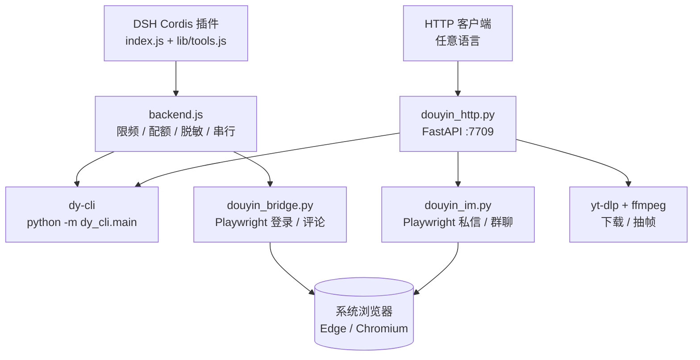

# dsh-douyin

把抖音接进 [DeepSeek Harness](https://github.com/deepseek-ai/deepseek-harness)：热榜、搜索、视频内容理解、私信/群聊，全部作为 DSH 的一等公民工具，另附一个可独立调用的本地 HTTP API。

> 基于 [`SakuraMat0u/dsh-douyin-toolkit`](https://github.com/SakuraMat0u/dsh-douyin-toolkit)（MIT）改造：
> 增加了 Linux/headless 适配、私信与群聊驱动、视频下载与抽帧、本地 HTTP API，并把所有服务器路径参数化。

<p>
  
  
  
  
</p>

---

## English summary

A Douyin toolkit for DeepSeek Harness (DSH) and any HTTP client. It reads the hot
list, searches videos, downloads videos and extracts frames for vision models,
and drives the web DM/group chat through Playwright — with dry-run **on by
default** and three independent gates before anything is actually sent. Based on
`SakuraMat0u/dsh-douyin-toolkit` (MIT); this fork adds Linux/headless support, an
IM driver, media download, and a local HTTP API.

---

## 目录

- [这是什么](#这是什么)
- [特性](#特性)
- [和上游的关系](#和上游的关系)
- [架构](#架构)
- [环境要求](#环境要求)
- [安装](#安装)
- [登录](#登录)
- [快速开始](#快速开始)
- [配置](#配置)
- [私信安全模型](#私信安全模型)
- [风险与合规](#风险与合规)
- [常见问题](#常见问题)
- [目录结构](#目录结构)
- [开发](#开发)
- [许可与致谢](#许可与致谢)

## 这是什么

一个 **DSH 插件**（Cordis Host 插件，工具直接注册到 `ctx.tools`，不是 MCP
server），外加一组可以单独调用的 Python 脚本。

它解决四件事：

1. **读得动**：热榜、搜索、视频详情、用户主页、评论。
2. **看得懂**：视频下载 → ffmpeg 抽帧 → 交给支持视觉的模型（比如 DeepSeek
   flash 的原生视觉），不需要自己实现视频理解。
3. **说得上话**：通过 Playwright 驱动抖音网页版，私信单个用户、给群聊发消息。
4. **接得住**：所有能力都能通过本地 HTTP API（默认 `127.0.0.1:7709`）暴露，
   任何语言写的上层程序都能调。

它**不做**：发布视频、批量点赞关注、养号、多账号矩阵、自动过验证码、签名逆向。

## 特性

| 能力 | 说明 | 需要登录 |
|---|---|---|
| 热榜 | 抖音热榜条目、热度、搜索链接 | 否 |
| 搜索 | 关键词搜索，`search_id` 链式翻页 | 是（多数情况） |
| 视频详情 | 文案、作者、互动数据、前 N 条评论 | 是 |
| 用户主页 | 简介、粉丝、近期作品 | 是 |
| 视频下载 | 移动端分享页解析无水印直链，绕过失效的 Douyin 提取器 | 是 |
| 抽帧 | ffmpeg 均匀抽 4–12 帧，供视觉模型使用 | 是 |
| 私信 / 群聊 | Playwright 驱动网页版，dry-run 默认，三道闸 | 是 |
| 登录状态机 | 可轮询的扫码/短信状态机（有头环境） | — |
| 状态自检 | 依赖、登录态、配额、上次错误一句话总结 | 否 |
| HTTP API | 上述能力的 JSON 接口 | 视接口 |

其它工程特性：

- **单 worker + 抖动**：所有后端调用串行，翻页 3–8 秒高斯抖动，独立调用
  1.8–3.2 秒，避免明显的机器人节奏。
- **小时配额 + 指数退避**：滚动 1 小时请求预算（默认 60），触发限流后
  1/2/4/8/15 分钟退避，不立即重试。
- **凭证脱敏**：cookie、`sessionid`、`passport_*`、`localStorage`、
  `storage_state` 不会出现在返回值、日志或报错里。
- **账号指纹**：记录首个登录账号的不可逆指纹，换号后写操作直接拒绝。
- **缺失即 `null`**：抖音数据稀疏，缺字段返回 `null`，不填 0、不猜。

## 和上游的关系

本仓库是 [`SakuraMat0u/dsh-douyin-toolkit`](https://github.com/SakuraMat0u/dsh-douyin-toolkit)
的改造版。上游是一个**只跑 Windows + Edge** 的只读 + 单条评论插件，本仓库在此
基础上加了：

| 变更 | 说明 |
|---|---|
| Linux / headless 适配 | 浏览器发现扩展到 Chromium/Chrome/Playwright 自带内核；无 X server 时自动降级 headless；进程清理加 POSIX 分支 |
| 私信 / 群聊 | 新增 `python/douyin_im.py`：Playwright 驱动网页版，dry-run 默认 + 双闸 + 可选白名单 + 串行锁 |
| 视频下载 / 抽帧 | 新增 `python/douyin_http.py`：移动端分享页解析无水印直链 + yt-dlp generic + ffmpeg 抽帧 |
| HTTP API | 把 dy-cli 与私信驱动包装成本地 JSON 服务（端口 7709） |
| 路径参数化 | 服务器绝对路径全部改为环境变量 / 相对路径 |
| 文档 | 新增 Linux 适配、Cookie 导出、HTTP API、安全说明 |

上游的核心设计（dy-cli 只读通道、错误码、限频、脱敏、登录状态机、账号指纹）
都保留了，没有重写。

## 架构



两条入口（DSH 插件 / HTTP）共享同一批 Python 脚本和同一个 `data/` 目录，互不
冲突：插件走子进程 + 自己的串行门；HTTP 服务另有进程级锁，避免同时开两个
Chromium。

## 环境要求

| 项 | 要求 | 备注 |
|---|---|---|
| Python | 3.10+ | 实测 3.10 / 3.14 |
| Node.js | 22+ | DSH 自带 |
| 浏览器 | Edge（Windows）/ Chromium 或 Chrome（Linux、macOS） | 也可 `playwright install chromium` |
| ffmpeg / ffprobe | 可选 | 只有抽帧需要 |
| yt-dlp | 可选 | 没有时会退回 `urllib` 直接下载 |
| 磁盘 | ≥ 1 GB | 成片缓存默认上限 800 MB |

## 安装

### 1. 克隆并建虚拟环境

```bash
git clone https://github.com/JianHeShui/dsh-douyin.git
cd dsh-douyin

python3 -m venv .venv
# Linux / macOS
.venv/bin/pip install -r python/requirements.txt
# Windows
# .venv\Scripts\pip install -r python\requirements.txt
```

需要 HTTP API 的话，再装一层（`requirements-http.txt` 是超集）：

```bash
.venv/bin/pip install -r python/requirements-http.txt
```

### 2. 准备浏览器

Windows 上装了 Edge 就不用管。Linux / macOS：

```bash
.venv/bin/playwright install chromium
# 国内网络慢可以走镜像：
# PLAYWRIGHT_DOWNLOAD_HOST=https://cdn.npmmirror.com/binaries/playwright \
#   .venv/bin/playwright install chromium
```

也可以用系统包（`apt install chromium`），插件会自动发现。要指定就用
`DOUYIN_BROWSER=/usr/bin/chromium`，或在插件配置里设 `edgePath`。

### 3. 装进 DSH

```bash
dsh plugin --profile desktop add file:$PWD
# 或按你的 profile 名： --profile web
```

插件自带 `cordis.patch.yml`，安装时会插入 `id: douyin` 的配置行。装完重启
DSH。自检：

```bash
# DSH 里直接调用 douyin_status
# 或者命令行
./scripts/selfcheck.sh          # Windows: .\scripts\selfcheck.ps1
```

### 4.（可选）起 HTTP 服务

```bash
./scripts/run-http.sh           # Windows: .\scripts\run-http.ps1
curl -s http://127.0.0.1:7709/health | jq .
```

常驻用 `deploy/douyin-api.service`（systemd 模板，记得改 `User=` 与路径）。

## 登录

**必须在有显示器的电脑上登录，再把 cookie 送到服务器。** 服务器 headless 环境
无法扫码、无法过滑块。

```bash
# 本地电脑上执行，会弹出浏览器窗口
.venv/bin/python tools/export_login_state.py
# 扫码登录成功后，自动写出 data/home/.dy/cookies/default.json

# 送到服务器
scp data/home/.dy/cookies/default.json user@server:~/dsh-douyin/data/home/.dy/cookies/default.json
ssh user@server 'chmod 600 ~/dsh-douyin/data/home/.dy/cookies/default.json'
```

完整流程、可选参数、过期处理见 [`docs/COOKIE-GUIDE.md`](docs/COOKIE-GUIDE.md)。

登录后验证：

```bash
curl -s -X POST http://127.0.0.1:7709/im/status | jq .
```

## 快速开始

### 在 DSH 里

```text
douyin_status                                   # 先看状态
douyin_hot({"count": 10})                       # 热榜
douyin_search({"keyword": "开源", "limit": 5})   # 搜索
douyin_video({"aweme_id": "7xxxxxxxxxxxxxx"})   # 视频详情
```

看视频内容（推荐路径）：

```text
POST /frames {"aweme_id": "...", "n": 8}   # 拿到 8 张帧
→ 把帧路径交给视觉模型，问"这条视频讲了什么"
```

在 DSH 里可以直接让 agent 完成这串动作；HTTP 侧则是两步：先 `/frames`，再把
返回的 `frames[]` 喂给任意支持图片输入的模型。

### HTTP

```bash
# 热榜
curl -s -X POST http://127.0.0.1:7709/trending | jq .

# 搜索
curl -s -X POST http://127.0.0.1:7709/search \
  -H 'Content-Type: application/json' \
  -d '{"keyword":"猫","count":5}' | jq .

# 下载 + 抽帧
curl -s -X POST http://127.0.0.1:7709/frames \
  -H 'Content-Type: application/json' \
  -d '{"aweme_id":"7xxxxxxxxxxxxxx","n":8}' | jq .

# 私信（默认 dry-run：只填框 + 截图 + 清空）
curl -s -X POST http://127.0.0.1:7709/im/send \
  -H 'Content-Type: application/json' \
  -d '{"to":"某某","text":"在吗"}' | jq .
```

完整接口、错误码、dry-run 语义见 [`docs/HTTP-API.md`](docs/HTTP-API.md)。

### 命令行（不经过 DSH / HTTP）

```bash
python python/douyin_im.py status
python python/douyin_im.py conversations --limit 20
python python/douyin_im.py groups --limit 20
python python/douyin_im.py send --to=某某 --text=在吗          # dry-run
DOUYIN_IM_ALLOW_SEND=1 python python/douyin_im.py send --to=某某 --text=在吗 --send
```

## 配置

### 插件配置（`cordis.patch.yml`）

装好后不要重复 `insert` 同一个 id；在 profile 的 `cordis.patch.yml` 顶层加同 id
覆盖行：

```yaml
- id: douyin
  name: dsh-douyin
  config:
    writesEnabled: false
    maxSearchPages: 2
    pythonPath: /opt/dsh-douyin/.venv/bin/python
    dataDir: /opt/dsh-douyin/data
    edgePath: /usr/bin/chromium
```

| 字段 | 默认 | 说明 |
|---|---|---|
| `enabled` | `true` | 关闭后不注册任何工具 |
| `writesEnabled` | `false` | 评论写操作总开关 |
| `toolEnabled` | 全 `true` | 单工具开关：`hot` / `search` / `video` / `user` / `status` / `login` / `verify` / `comment` / `publish` |
| `maxResults` | `20` | 单次返回上限，硬上限 20 |
| `maxSearchPages` | `3` | 单次搜索翻页上限，硬上限 3 |
| `hourlyRequestBudget` | `60` | 滚动 1 小时请求预算 |
| `pageDelayMinMs` / `pageDelayMaxMs` | `3000` / `8000` | 翻页抖动区间 |
| `callDelayMinMs` / `callDelayMaxMs` | `1800` / `3200` | 调用间隔区间 |
| `pythonPath` | 空 | 默认 `<repo>/.venv/bin/python`（Windows 为 `Scripts\python.exe`） |
| `dataDir` | 空 | 默认 `<repo>/data` |
| `edgePath` | 空 | 默认自动发现 |
| `logLevel` | `info` | `silent` / `error` / `info` / `debug` |

### 环境变量（HTTP 服务 / 独立脚本）

完整列表见 [`.env.example`](.env.example)。常用：

| 变量 | 默认 | 说明 |
|---|---|---|
| `DOUYIN_DATA_DIR` | `<repo>/data` | 数据目录（cookie、profile、日志） |
| `DOUYIN_PYTHON` | 当前解释器 | 装了 dy-cli 的解释器 |
| `DOUYIN_BROWSER` | 自动发现 | 浏览器可执行文件 |
| `DOUYIN_HEADLESS` | 私信驱动 `1` | `0` 开窗口调试 |
| `DOUYIN_COOKIE_FILE` | `<DATA>/home/.dy/cookies/default.json` | storage_state |
| `DOUYIN_MEDIA_DIR` | `<DATA>/media` | 成片 / 帧缓存 |
| `DOUYIN_HTTP_HOST` / `DOUYIN_HTTP_PORT` | `127.0.0.1` / `7709` | 监听地址 |
| `DOUYIN_IM_ALLOW_SEND` | 未设置 | `1` 才允许真实发送 |
| `DOUYIN_IM_ALLOW_TO` | 未设置 | 发送白名单，逗号分隔 |
| `DOUYIN_IM_TIMEOUT` | `180` | 单次私信操作超时（秒） |

## 私信安全模型

真实发出一条私信需要**同时**满足：

1. 调用方显式要求：HTTP 传 `send: true`，CLI 传 `--send`；
2. 服务端总闸打开：`DOUYIN_IM_ALLOW_SEND=1`；
3. 如果设了 `DOUYIN_IM_ALLOW_TO`，目标必须在白名单里。

缺第 1/2 道：文本填进输入框、截图、然后清空，**没有任何消息发出**，响应里
`data.dry_run` 为 `true`。
缺第 3 道：直接 `TARGET_NOT_ALLOWED`，连输入框都不填。

另外还有几层保护：

- 群发前先校验打开的会话标题与目标群名匹配，不匹配立即 `NOT_GROUP` 中止；
- 发送后必须确认到自己的消息气泡，确认不到报 `SEND_UNCONFIRMED` 并**不自动重试**；
- 全局文件锁，同一时刻只有一个浏览器实例；
- 超时用进程组回收，避免 Chromium 变孤儿吃满内存。

评论（`douyin_comment`）是另一套：需要 `writesEnabled: true` +
`dry_run: false` + `confirm: true`，且账号指纹必须匹配。

## 风险与合规

**请务必读完这一节再使用。**

- 本项目使用**非官方接口**和浏览器自动化，不是抖音开放平台。接口、DOM 随时
  可能变，项目不保证可用性。
- 抖音有风控系统。高频请求、批量操作、机房 IP、多个实例共用 profile，都可能
  触发限流、验证码，极端情况导致**账号被限制或封禁**。限频参数只能降低概率，
  不能消除风险。
- 私信功能会以**你的账号身份**给真实的人发消息。误发、发错人、冒犯他人，后果
  由使用者承担。默认 dry-run 就是为了让你先看清楚会发生什么。
- 不要用于：垃圾营销、骚扰、诈骗、刷量、养号、多账号矩阵，或任何违反抖音
  用户协议与当地法律的行为。
- 不要绕过验证码，不要接打码平台，不要伪造设备指纹。
- 仅供**个人学习与研究**使用。因使用本项目产生的任何后果，作者不承担责任。
- 如果抖音官方提供了你要的能力（开放平台 API），优先用它。

## 常见问题

**Q：`douyin_status` 说"未找到可用浏览器"？**

装 Chromium（`playwright install chromium`），或设 `DOUYIN_BROWSER` /
`edgePath`。`/health` 会告诉你具体缺什么。

**Q：搜索/详情返回 `not_authenticated` 或空？**

cookie 没导出或已过期。按 [`docs/COOKIE-GUIDE.md`](docs/COOKIE-GUIDE.md) 重新
导出。热榜不需要登录，可以先用它确认网络通。

**Q：`challenge_required` / `RISK_CONTROL`？**

触发了安全验证。**不要**写脚本硬刷。停一段时间，人工在可见窗口完成验证再试。
机房 IP 更容易触发。

**Q：服务器上 `login_start` 一直停在 qrcode？**

预期行为：headless 没有可见窗口，二维码只能落盘成截图。请在本地导出 cookie。

**Q：`profile_in_use`？**

专用 profile 被上一次没退干净的浏览器占用。私信驱动会自己清理带本 profile 的
进程；必要的话手动 `pkill -f <dataDir>/im-profile`。

**Q：抽帧失败 / 只有视频没有帧？**

装 ffmpeg 和 ffprobe（`apt install ffmpeg`），或设 `DOUYIN_FFMPEG` /
`DOUYIN_FFPROBE`。

**Q：视频下载失败，提示分享页被风控？**

直链解析依赖移动端分享页。被风控时换个时间重试；cookie 过期也会导致失败。

**Q：能同时跑 DSH 插件和 HTTP 服务吗？**

可以。两者共享 `data/`，但私信驱动有文件锁，同一时刻只会有一个在跑浏览器。
同时开两个实例做搜索会更快触发限流，不建议。

**Q：支持 Windows 吗？**

支持。浏览器发现、进程清理、路径都保留了 Windows 分支；`scripts/` 下有
`.ps1` 版本。

**Q：怎么换账号？**

删掉 `data/state/account.json`，重新导出 cookie。

## 目录结构

```text
dsh-douyin/
├── README.md                    # 本文件
├── LICENSE                      # MIT（含上游版权声明）
├── CHANGELOG.md
├── .env.example                 # 所有环境变量模板
├── .gitignore                   # 排除 cookie / venv / data / 缓存
├── package.json                 # DSH 插件元数据（dsh.bundle.patch）
├── cordis.patch.yml             # 插件挂载与默认配置
├── icon.svg
├── index.js                     # DSH 入口：注册工具
├── lib/
│   ├── backend.js               # 子进程 / 限频 / 配额 / 脱敏 / 浏览器发现
│   ├── tools.js                 # 11 个工具定义
│   └── normalize.js             # 响应归一化（缺失即 null）
├── python/
│   ├── douyin_bridge.py         # Playwright 登录状态机 / 评论
│   ├── douyin_im.py             # 私信 / 群聊驱动（dry-run 默认）
│   ├── douyin_http.py           # HTTP API（FastAPI, :7709）
│   ├── dy_query.py              # 搜索分页补丁
│   ├── requirements.txt
│   └── requirements-http.txt
├── tools/
│   ├── export_login_state.py    # 本地扫码登录 → 导出 storage_state
│   └── probe_im.py              # DOM 探测（前端改版后对照选择器）
├── tests/
│   ├── fixture_chat.html        # 私信 DOM 仿真页
│   └── test_fixture.py          # dry-run / 发送 / 群名匹配 的离线测试
├── scripts/
│   ├── run-http.sh / .ps1       # 启动 HTTP 服务
│   └── selfcheck.sh / .ps1      # 环境自检
├── deploy/
│   └── douyin-api.service       # systemd 模板
├── examples/
│   └── standalone.patch.yml     # 不走 bundle 管理器的挂载方式
└── docs/
    ├── COOKIE-GUIDE.md          # 登录与 cookie 导出
    ├── HTTP-API.md              # 接口文档与错误码
    ├── SECURITY.md              # 安全模型
    └── LINUX-ADAPTER.md         # Linux 适配说明
```

## 开发

```bash
# JS 语法检查
node --check index.js
node --check lib/backend.js
node --check lib/tools.js
node --check lib/normalize.js
# 或
npm run check

# Python 语法检查
python -m py_compile python/*.py tools/*.py tests/*.py

# 离线跑私信逻辑测试（不联网、不发消息）
python tests/test_fixture.py
```

改工具：在 `lib/tools.js` 的 `createTools()` 里加 `defineTool({...})`，然后在
`index.js` 的 `TOOL_SWITCH`、`cordis.patch.yml` 的 `toolEnabled`、README 的工具
表里各补一行。

改选择器：抖音前端改版后，跑 `python tools/probe_im.py` 采集新的 class /
placeholder，对照 `python/douyin_im.py` 顶部的常量调整。

## 许可与致谢

MIT，见 [LICENSE](LICENSE)。上游
[`SakuraMat0u/dsh-douyin-toolkit`](https://github.com/SakuraMat0u/dsh-douyin-toolkit)
的版权声明保留在 LICENSE 中。

这个项目站在很多人的肩膀上：

- [`Youhai020616/douyin`](https://github.com/Youhai020616/douyin)（`dy-cli`）——
  热榜、搜索、用户资料的逆向接口与 JSON 信封
- [`Kuhakucai/douyin-mcp`](https://github.com/Kuhakucai/douyin-mcp) —— 登录态判定、
  专用 profile、单 worker 设计参考
- [`WJZ-P/douyin-upload-mcp-skill`](https://github.com/WJZ-P/douyin-upload-mcp-skill)
  —— 多阶段登录状态机参考
- [`NanmiCoder/MediaCrawler`](https://github.com/NanmiCoder/MediaCrawler) ——
  `search_id` 链式翻页与风控坑位
- [`nisew2/dsh-whale-dive`](https://github.com/nisew2/dsh-whale-dive) —— 最接近的
  DSH 只读插件
- [`cong120/douyin-auto-fire`](https://github.com/cong120/douyin-auto-fire) ——
  `douyin_im.py` 的 DOM 选择器来源
- [Playwright](https://playwright.dev/)、[FastAPI](https://fastapi.tiangolo.com/)、
  [yt-dlp](https://github.com/yt-dlp/yt-dlp)、[FFmpeg](https://ffmpeg.org/)

以及 [DeepSeek Harness](https://github.com/deepseek-ai/deepseek-harness) 提供的
插件运行时。
