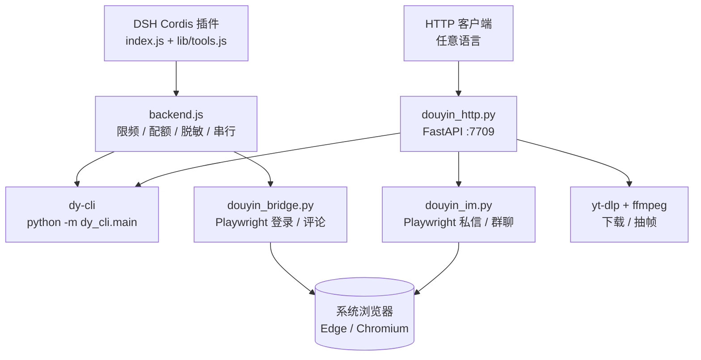
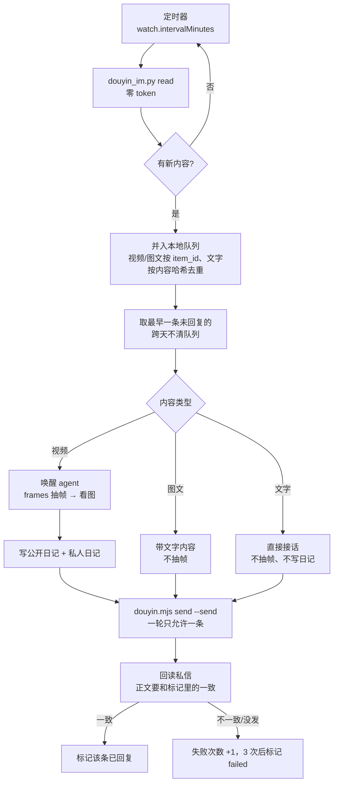

# dsh-douyin-whale — 大肥鱼刷抖音

大肥鱼刷抖音：把热榜、搜索、视频内容理解、私信/群聊接入 DSH，另附一个可独立调用的本地 HTTP API，以及一个「主人发视频 → 大肥鱼看完写日记 → 私信回复」的定时调度器。

<p>
  
  
  
  
</p>

---

## English summary

A Douyin toolkit for Dafeiyu (大肥鱼刷抖音) and DeepSeek Harness (DSH), also usable
from any HTTP client. It reads the hot list, searches videos, downloads videos
and extracts frames for vision models, sends videos as native share cards, and
drives web DM/group chat through Playwright — with dry-run **on by default** and
independent gates before anything is actually sent. A bundled scheduler watches
the owner's DMs, wakes an agent on each new video, and only marks a video done
after a read-back proves the reply was delivered.

---

## 目录

- [这是什么](#这是什么)
- [特性](#特性)
- [项目定位](#项目定位)
- [架构](#架构)
- [大肥鱼流水线（定时看私信）](#大肥鱼流水线定时看私信)
- [环境要求](#环境要求)
- [安装](#安装)
- [登录](#登录)
- [快速开始](#快速开始)
- [Node 适配层](#node-适配层)
- [配置](#配置)
- [私信安全模型](#私信安全模型)
- [风险与合规](#风险与合规)
- [常见问题](#常见问题)
- [目录结构](#目录结构)
- [开发](#开发)
- [许可](#许可)

## 这是什么

一个 **DSH 插件**（Cordis Host 插件，工具直接注册到 `ctx.tools`，不是 MCP
server），外加一组可以单独调用的 Python 脚本。

它解决五件事：

1. **读得动**：热榜、搜索、视频详情、用户主页、评论。
2. **看得懂**：视频下载 → ffmpeg 抽帧 → 交给支持视觉的模型（比如 DeepSeek
   flash 的原生视觉），不需要自己实现视频理解。
3. **说得上话**：通过 Playwright 驱动抖音网页版，私信单个用户、给群聊发消息，
   或者把视频以**原生分享卡片**发出去（文本链接在抖音里点不开，还会被吞）。
   HTTP API 默认 headless（无窗口弹出）；手动调试设 `DOUYIN_HEADLESS=0` 可看操作过程。
4. **接得住**：所有能力都能通过本地 HTTP API（默认 `127.0.0.1:7709`）暴露，
   任何语言写的上层程序都能调。
5. **跑得久**：附一个调度器，定时读主人私信，有新视频才唤醒 agent，看完写日记、
   回私信，并把「回没回成功」用回读证据确认。

它**不做**：发布视频、批量点赞关注、养号、多账号矩阵、自动过验证码、签名逆向。

## 特性

| 能力 | 说明 | 需要登录 |
|---|---|---|
| 热榜 | 抖音热榜条目、热度、搜索链接 | 否 |
| 搜索 | 关键词搜索，`search_id` 链式翻页 | 是（多数情况） |
| 视频详情 | 文案、作者、互动数据、前 N 条评论 | 是 |
| 用户主页 | 简介、粉丝、近期作品 | 是 |
| 视频下载 | 移动端分享页解析无水印直链，绕过失效的 Douyin 提取器 | 是 |
| 抽帧 | ffmpeg 均匀抽 4–12 帧，供视觉模型使用 | 是 |
| 私信 / 群聊 | Playwright 驱动网页版，dry-run 默认，三道闸 | 是 |
| 分享卡片 | 走抖音自己的「分享给朋友」，把视频以原生卡片发出并回读确认 | 是 |
| 本地记忆 | 每位联系人一份 `dm-*.json`，只存本机，合并去重、有上限 | — |
| 发送闸 | 两次发送最少隔 30 秒；风控/失败自动进冷却，冷却期内不开浏览器 | — |
| 登录状态机 | 可轮询的扫码/短信状态机（有头环境） | — |
| 状态自检 | 依赖、登录态、配额、上次错误一句话总结 | 否 |
| HTTP API | 上述能力的 JSON 接口 | 视接口 |

其它工程特性：

- **单 worker + 抖动**：所有后端调用串行，翻页 3–8 秒高斯抖动，独立调用
  1.8–3.2 秒，避免明显的机器人节奏。
- **小时配额 + 指数退避**：滚动 1 小时请求预算（默认 60），触发限流后
  1/2/4/8/15 分钟退避，不立即重试。
- **凭证脱敏**：cookie、`sessionid`、`passport_*`、`localStorage`、
  `storage_state` 不会出现在返回值、日志或报错里。
- **账号指纹**：记录首个登录账号的不可逆指纹，换号后写操作直接拒绝。
- **缺失即 `null`**：抖音数据稀疏，缺字段返回 `null`，不填 0、不猜。

## 项目定位

`dsh-douyin-whale` 是大肥鱼在抖音侧的工具层：先把“看什么、看到了什么”跑通，再逐步加互动。

- **只读优先**：热榜、搜索、视频详情、评论、下载、抽帧都不产生公开写操作。
- **写操作默认关闭**：私信/群聊必须显式打开三道闸；评论默认 dry-run。
- **真实浏览器**：登录和评论使用本机 Edge/Chrome + 独立 profile，不使用指纹注入，不绕过验证码。
- **本地优先**：cookie、profile、下载物都在 `data/`，HTTP 服务只监听 `127.0.0.1`。
- **可接 ZCode**：HTTP API 可以被任意调度器调用，和 b 站那套 `scheduler + 日记` 共用同一套思路。

## 架构



两条入口（DSH 插件 / HTTP）共享同一批 Python 脚本和同一个 `data/` 目录，互不
冲突：插件走子进程 + 自己的串行门；HTTP 服务另有进程级锁，避免同时开两个
Chromium。

## 大肥鱼流水线（定时看私信）

不是自主刷视频，而是**只看主人发来的内容**：主人发一条，大肥鱼看一条、写日记、回一句。



### 几处设计是为解决具体问题

| 设计 | 要解决的问题 |
|---|---|
| 按 `item_id` 排队，不只依赖当前页面 | 私信页只渲染十来条，新消息会把老卡片挤出 DOM；只看「页面上有什么」会漏掉还没处理的视频 |
| 回读确认后才标记已回复 | agent「跑完了」不等于私信发出去了——它卡在登录态上也会照常返回成功 |
| 每轮新会话 + 本地记忆 | 上下文底座从约 260k 降到约 30k；记忆只给最近 10 行和长期事实，不把整段历史塞进提示词 |
| 发送闸 + 冷却 | 连续发送会触发风控，随后整段会话被服务端作废 |

### 表情包（v1.5.0）

大肥鱼会斗图了。图库来自 dsh-meme（`~/.dsh/meme-packs`，大肥鱼包 24 张，SQLite 索引带
caption/关键词，六个情绪桶）：

```bash
node douyin.mjs meme pick "开心"                      # 挑一张，返回 path/caption
node douyin.mjs send --to "<昵称>" --text "一句话" \
  --image "<pick 给的 path>" --send                   # 图 + caption 一起发
```

- 收到主人发的收藏表情（aweType 501）或聊天图片（2702）会入队（`kind=sticker`），
  处理前自动把图下载到 `data/media/dm-images/` 给模型看，再挑同情绪的图回敬。
- 节奏：每轮按 `meme.probability`（默认 0.3）允许配图，`meme.maxPerDay`（默认 6）防刷屏，
  面板设置页可调。
- 安全边界：`--image` 只认图库白名单目录（`DOUYIN_MEME_ROOTS` / `~/.dsh/meme-packs`），
  目录不存在时 fail-closed 拒发；扩展名/大小钳制；走同一套发送双闸和冷却。
- 细节坑（实测）：**点「发送 (N)」前必须等预览图从本地 blob 换成 douyinpic CDN 地址**，
  否则消息永远卡「发送中」、对方收不到；caption 不随图走，是独立文本消息。

### 命令

```bash
# 启动（Windows 用 VBS 起，不弹控制台窗口）
cscript //nologo start-whale.vbs
node scheduler/scheduler.mjs --status        # 状态
node scheduler/scheduler.mjs --stop          # 停止

# 排查用（都不唤醒模型、不花钱）
node scheduler/scheduler.mjs --dry-tick      # 打印本轮会处理哪条
node scheduler/scheduler.mjs --memory-sync   # 把当前会话灌进本地记忆

# 立刻跑一轮
node scheduler/scheduler.mjs --watch-now
```

状态和记忆都在 `~/.dsh/`：

| 文件 | 内容 |
|---|---|
| `douyin-whale.config.json` | 主人昵称、检查间隔、时段、每日上限 |
| `douyin-whale-state.json` | 内容队列、已回复 id、今日计数 |
| `douyin-whale-scheduler.log` | 运行日志 |
| `memory/dm-<昵称>.json` | 每位联系人的对话记忆（只存本机，不进仓库和日志） |
| `whale-diary.md` / `whale-diary-private.md` | 公开 / 私人日记 |

### 值班大脑（发布版，不依赖 ZCode）

插件里有一条**常驻值班会话**（DSH 宿主的 agents 服务，会话 id 固定为
`douyin-whale-duty-v1`）：装载后 15 秒跑第一轮，之后按配置间隔轮询。
模型和上下文由宿主管，插件只负责投任务、收结果、回读确认。

**模型路由**：值班会话默认跟随宿主的 agent 默认模型（`dsh-agent-default-model`）；
没有官方 DeepSeek key 时，可在插件配置里写 `duty.provider`/`duty.model` 指向
宿主 `dsh-llm-pi-ai` 声明的自定义网关（OpenAI 兼容，如本机 wb2api），key 走
启动环境（`apiKeyEnv` 引用的变量，不进配置文件）：

```yaml
# 插件配置（cordis.patch.yml 的 douyin-whale 行）
duty:
  provider: wb2api
  model: cn:deepseek-v4.1-flash
```

```yaml
# 宿主用户设置（~/.dsh/settings.yaml）
llm-pi-ai:
  providers:
    wb2api:
      displayName: wb2api
      apiKeyEnv: WB2API_API_KEY
      api: openai-completions
      baseURL: http://127.0.0.1:7863/v1
      models:
        - id: cn:deepseek-v4.1-flash
          contextWindow: 1000000
```

值班环境的已知限制：宿主后台会话没有 shell/文件工具（审批类工具不下发），
所以值班模式**发私信用 `douyin_dm_send` 工具、挑表情用 `douyin_meme_pick`**，
视频按 `douyin_video` 文案回复（不抽帧）、不写日记；宿主工具结果暂不能带图，
值班模型看不到主人发的图（按附言/上下文挑情绪）。全功能路径仍是独立调度器
（ZCode 版）。

生命周期照抄 dsh-douyin-scroll 值班鱼的三步链：`agents.get(sid)` 找 live →
`resume({resumeSessionId})` 跨重启恢复 → `create({sessionId, meta, setup})`
兜底；create 撞「已存在」回头再 get。人设通过 `setup` 的
`systemPrompt.section` 注入，只在该会话生效。宿主没有 agents 能力时整块
降级为一条日志，工具和面板不受影响（可用配置 `whaleEnabled: false` 关闭）。

投递给会话的消息是「够格进会话日志」的 user 消息（id / role / source / content
四件套，缺一宿主会写坏日志）；完成检测轮询 `agent.status`，但**回读私信才是
标记已回复的真判据**。

### 暂不支持的

- **自动恢复登录**：抖音在服务端作废旧会话时，本地 cookie 还在、页面已经要扫码；
  偶发还要求滑块验证，那一步只能人工完成。

> 图文（`aweType=0` 且带 `itemId`）现在会按文字内容回复（不抽帧），不再静默跳过；
> 纯文字私信也会入队，走轻量接话路径。

### 设置页面板

装进 DSH 后，设置里会出现「大肥鱼刷抖音」一页（`client.js`，宿主注入，无构建步骤）：
运行状态、内容队列（旧→新，带已回复 / 待回复 / 失败标记，视频·图文·文字三种）、
配置（主人昵称 / 检查间隔 / 每日上限 / 时段）、启停本地调度器、值班会话自检、
登录引导（二维码内嵌）、日志 tail。

- 面板**只读**运行时状态，状态唯一来源是 `~/.dsh/` 下的文件（调度器维护），
  写操作仅限改配置和启停调度器——**不提供绕过发送闸的发消息入口**。
- 需要宿主提供 `webServer` / `slots` 两个能力；没有时插件照常工作，只是没有
  这页（启动时会打一条 `webServer_unavailable` 日志）。值班大脑另外需要
  `agents`，没有时只打日志，工具和面板不受影响。
- 值班大脑和独立调度器共用 `~/.dsh` 状态，**二选一**；面板在值班大脑启用时会
  禁用「启动本地调度器」。值班会话自检只拉会话，不投任务、不发私信。
- 后端路由挂在 `/api/douyin-whale/*`，接口一览：

| 方法 | 路径 | 作用 |
|---|---|---|
| GET | `/status` | 概览（调度器存活、今日计数、发送闸、队列、记忆、值班大脑/ZCode 可用性） |
| GET | `/queue` | 内容队列全量 + 每条状态 |
| GET | `/log?n=80&source=plugin\|scheduler` | 日志尾部（默认插件值班日志，最多 400 行） |
| GET | `/config` | 当前配置（含默认值兜底） |
| POST | `/config` | 改配置（只接受已知字段并钳制范围） |
| POST | `/scheduler/start` | 静默启动独立调度器（借 VBS；没装 ZCode 时返回 400） |
| POST | `/scheduler/stop` | 停止调度器 |
| POST | `/duty/selftest` | 只拉值班会话（get/resume/create），不投任务、不发私信 |
| GET | `/login/status` | 扫码登录阶段（idle/starting/qr/ok/failed） |
| GET | `/login/qr.png` | 内嵌二维码（只在扫码进程活着且路径安全时下发） |
| POST | `/login/qr` | 起一个无头扫码进程 |
| GET | `/gate`、`/memory` | 发送闸剩余冷却 / 记忆占用 |

### 不装 DSH 先看面板

`tools/panel-preview/server.mjs` 伪造宿主的三样东西（`__ModuleLoader__`、
`require('react')`、假 slots），`/api/*` 挂的就是真实的路由实现：

```bash
npm run preview          # 打开 http://127.0.0.1:7701
```

数据目录是 `data/panel-preview-home/`（首次启动自动写入样例队列和日志），
在这里随便点都不会影响真实调度器。React UMD 放在 `tools/panel-preview/vendor/`
（gitignored，从 npmmirror 下载）。

```bash
npm test                 # 47 项离线断言：安全 / 回读 / 发送闸 / 记忆 / 面板状态 / API 路由
```

## 环境要求

| 项 | 要求 | 备注 |
|---|---|---|
| Python | 3.10+ | 实测 3.10 / 3.14 |
| Node.js | 22+ | DSH 自带 |
| 浏览器 | Edge（Windows）/ Chromium 或 Chrome（Linux、macOS） | 也可 `playwright install chromium` |
| ffmpeg / ffprobe | 可选 | 只有抽帧需要 |
| yt-dlp | 可选 | 没有时会退回 `urllib` 直接下载 |
| 磁盘 | ≥ 1 GB | 成片缓存默认上限 800 MB |

## 安装

### 1. 克隆并建虚拟环境

```bash
git clone https://github.com/jackey670/dsh-douyin-whale.git
cd dsh-douyin-whale

python3 -m venv .venv
# Linux / macOS
.venv/bin/pip install -r python/requirements.txt
# Windows
# .venv\Scripts\pip install -r python\requirements.txt
```

需要 HTTP API 的话，再装一层（`requirements-http.txt` 是超集）：

```bash
.venv/bin/pip install -r python/requirements-http.txt
```

### 2. 准备浏览器

Windows 上装了 Edge 就不用管。Linux / macOS：

```bash
.venv/bin/playwright install chromium
# 国内网络慢可以走镜像：
# PLAYWRIGHT_DOWNLOAD_HOST=https://cdn.npmmirror.com/binaries/playwright \
#   .venv/bin/playwright install chromium
```

也可以用系统包（`apt install chromium`），插件会自动发现。要指定就用
`DOUYIN_BROWSER=/usr/bin/chromium`，或在插件配置里设 `edgePath`。

### 3. 装进 DSH

```bash
dsh plugin --profile desktop add file:$PWD
# 或按你的 profile 名： --profile web
```

插件自带 `cordis.patch.yml`，安装时会插入 `id: douyin` 的配置行。装完重启
DSH。自检：

```bash
# DSH 里直接调用 douyin_status
# 或者命令行
./scripts/selfcheck.sh          # Windows: .\scripts\selfcheck.ps1
```

### 4.（可选）起 HTTP 服务

```bash
./scripts/run-http.sh           # Windows: .\scripts\run-http.ps1
curl -s http://127.0.0.1:7709/health | jq .
```

常驻用 `deploy/douyin-api.service`（systemd 模板，记得改 `User=` 与路径）。

## 登录

运行时会用一个**持久化浏览器 profile**（默认 `<dataDir>/im-profile`）保存登录态。
`dataDir` 按安装方式选：开发 checkout 是 `<repo>/data`，打包安装是
`~/.dsh/douyin-whale`（可以用配置里的 `dataDir` 覆盖），登录态/队列/日志都在
这里面，升级重装不会丢。它和运行用的是同一份目录，所以重启对抖音来说只是
「同一个浏览器重启」，不会被当成新设备——这一点很关键，用 `storage_state` 每次
新建 context 会被判定为连续换设备，表现为「读消息正常、一发私信就掉登录」。

```bash
# 单机：直接在本机登录，写进运行时用的那个 profile
.venv/bin/python tools/export_login_state.py

# 会弹出浏览器窗口：扫码；如果抖音要求滑块，就在这个窗口里拖过去
```

登录后验证：

```bash
curl -s -X POST http://127.0.0.1:7709/im/status | jq .
# 或直接用命令行
python python/douyin_im.py status
```

### 服务器 / 无显示器的情况

```bash
# 1) 在有显示器的电脑上登录并导出
.venv/bin/python tools/export_login_state.py --out ./cookies.json

# 2) 送到服务器
scp cookies.json user@server:~/dsh-douyin-whale/data/home/.dy/cookies/default.json
ssh user@server 'chmod 600 ~/dsh-douyin-whale/data/home/.dy/cookies/default.json'
```

`data/home/.dy/cookies/default.json` 只在 profile 里**还没有** sessionid 时被灌入
一次，不会覆盖已有登录态。

### 没有显示器又只想出个二维码

```bash
python tools/login_headless.py --timeout 600
# 打出 {"phase":"qr","qr":".../data/im-shots/login-qr.png"}
# PNG 已经裁到二维码区域（找不到正方形元素才退回整页），手机直接扫
```

⚠️ 这条只在**不需要滑块验证**时可用——验证码必须有人在真实窗口里操作，项目不会
也不会尝试绕过它。登录页如果直接弹滑块/拼图，脚本会在 20 秒内以
`{"phase":"failed","captcha":true}` 结束并提示改用有头窗口；不会干等超时，
也不会把风控页当成二维码。面板里的「出二维码」走的是同一个脚本。

### 怎么判断是「真掉登录」还是页面没加载好

cookie 存在**不代表**登录有效：抖音会在服务端作废会话，`sessionid` 还躺在 profile
里，但页面已经要求重新扫码。所以判定必须看页面（登录面板是否可见），不能只看
cookie。`status` 报 `NEED_LOGIN` 就是真失效，需要重新登录。

完整流程、可选参数、过期处理见 [`docs/COOKIE-GUIDE.md`](docs/COOKIE-GUIDE.md)。

## 快速开始

### 在 DSH 里

```text
douyin_status                                   # 先看状态
douyin_hot({"count": 10})                       # 热榜
douyin_search({"keyword": "开源", "limit": 5})   # 搜索
douyin_video({"aweme_id": "7xxxxxxxxxxxxxx"})   # 视频详情
```

看视频内容（推荐路径）：

```text
POST /frames {"aweme_id": "...", "n": 8}   # 拿到 8 张帧
→ 把帧路径交给视觉模型，问"这条视频讲了什么"
```

在 DSH 里可以直接让 agent 完成这串动作；HTTP 侧则是两步：先 `/frames`，再把
返回的 `frames[]` 喂给任意支持图片输入的模型。

### HTTP

```bash
# 热榜
curl -s -X POST http://127.0.0.1:7709/trending | jq .

# 搜索
curl -s -X POST http://127.0.0.1:7709/search \
  -H 'Content-Type: application/json' \
  -d '{"keyword":"猫","count":5}' | jq .

# 下载 + 抽帧
curl -s -X POST http://127.0.0.1:7709/frames \
  -H 'Content-Type: application/json' \
  -d '{"aweme_id":"7xxxxxxxxxxxxxx","n":8}' | jq .

# 私信（默认 dry-run：只填框 + 截图 + 清空；HTTP API 默认 headless 无窗口）
curl -s -X POST http://127.0.0.1:7709/im/send \
  -H 'Content-Type: application/json' \
  -d '{"to":"某某","text":"在吗"}' | jq .

# 真实发送（需要 DOUYIN_IM_ALLOW_SEND=1 环境变量 + send=true）
curl -s -X POST http://127.0.0.1:7709/im/send \
  -H 'Content-Type: application/json' \
  -d '{"to":"某某","text":"在吗","send":true}' | jq .
```

完整接口、错误码、dry-run 语义见 [`docs/HTTP-API.md`](docs/HTTP-API.md)。

### Node 适配层

给 agent / 调度器用的薄封装，默认会自动拉起本地 HTTP API：

```bash
node douyin.mjs help
node douyin.mjs health
node douyin.mjs search "猫" --count 5
node douyin.mjs frames <aweme_id|分享链接> --n 8
node douyin.mjs watch "猫" --count 5 --n 6   # 选一条没看过的视频并抽帧
node douyin.mjs trending
node douyin.mjs status
node douyin.mjs read-dm --from 某位好友 --limit 20        # 读私信（含视频卡片 id）
node douyin.mjs share --aweme <id> --to 某位好友          # 分享卡片（默认 dry-run）
DOUYIN_IM_ALLOW_SEND=1 node douyin.mjs share --aweme <id> --to 某位好友 --send
```

如果不想让它自己起服务，加 `--no-start`；要指定地址，加 `--base-url`。

### 命令行（不经过 DSH / HTTP）

```bash
python python/douyin_im.py status
python python/douyin_im.py conversations --limit 20
python python/douyin_im.py groups --limit 20
python python/douyin_im.py read --from 某位好友 --limit 20
python python/douyin_im.py send --to=某某 --text=在吗          # dry-run
DOUYIN_IM_ALLOW_SEND=1 python python/douyin_im.py send --to=某某 --text=在吗 --send
python python/douyin_im.py gate                 # 看发送闸/冷却剩余
python python/douyin_im.py gate --clear         # 手动清除冷却
```

## 配置

### 插件配置（`cordis.patch.yml`）

装好后不要重复 `insert` 同一个 id；在 profile 的 `cordis.patch.yml` 顶层加同 id
覆盖行：

```yaml
- id: douyin-whale
  name: dsh-douyin-whale
  config:
    writesEnabled: false
    maxSearchPages: 2
    pythonPath: /opt/dsh-douyin-whale/.venv/bin/python
    dataDir: /opt/dsh-douyin-whale/data
    edgePath: /usr/bin/chromium
```

| 字段 | 默认 | 说明 |
|---|---|---|
| `enabled` | `true` | 关闭后不注册任何工具 |
| `writesEnabled` | `false` | 评论写操作总开关 |
| `toolEnabled` | 全 `true` | 单工具开关：`hot` / `search` / `video` / `user` / `status` / `login` / `verify` / `comment` / `publish` |
| `maxResults` | `20` | 单次返回上限，硬上限 20 |
| `maxSearchPages` | `3` | 单次搜索翻页上限，硬上限 3 |
| `hourlyRequestBudget` | `60` | 滚动 1 小时请求预算 |
| `pageDelayMinMs` / `pageDelayMaxMs` | `3000` / `8000` | 翻页抖动区间 |
| `callDelayMinMs` / `callDelayMaxMs` | `1800` / `3200` | 调用间隔区间 |
| `pythonPath` | 空 | 默认 `<repo>/.venv/bin/python`（Windows 为 `Scripts\python.exe`） |
| `dataDir` | 空 | 默认 `<repo>/data` |
| `edgePath` | 空 | 默认自动发现 |
| `logLevel` | `info` | `silent` / `error` / `info` / `debug` |

### 环境变量（HTTP 服务 / 独立脚本）

完整列表见 [`.env.example`](.env.example)。常用：

| 变量 | 默认 | 说明 |
|---|---|---|
| `DOUYIN_DATA_DIR` | `<repo>/data` | 数据目录（cookie、profile、日志） |
| `DOUYIN_PYTHON` | 当前解释器 | 装了 dy-cli 的解释器 |
| `DOUYIN_BROWSER` | 自动发现 | 浏览器可执行文件 |
| `DOUYIN_HEADLESS` | HTTP API `1`，手动 `0` | `1` 无窗口弹出；`0` 开窗口调试 |
| `DOUYIN_COOKIE_FILE` | `<DATA>/home/.dy/cookies/default.json` | storage_state |
| `DOUYIN_MEDIA_DIR` | `<DATA>/media` | 成片 / 帧缓存 |
| `DOUYIN_HTTP_HOST` / `DOUYIN_HTTP_PORT` | `127.0.0.1` / `7709` | 监听地址 |
| `DOUYIN_IM_ALLOW_SEND` | 未设置 | `1` 才允许真实发送 |
| `DOUYIN_IM_ALLOW_TO` | 未设置 | 发送白名单，逗号分隔 |
| `DOUYIN_IM_TIMEOUT` | `180` | 单次私信操作超时（秒） |

## 私信安全模型

真实发出一条私信需要**同时**满足：

1. 调用方显式要求：HTTP 传 `send: true`，CLI 传 `--send`；
2. 服务端总闸打开：`DOUYIN_IM_ALLOW_SEND=1`；
3. 如果设了 `DOUYIN_IM_ALLOW_TO`，目标必须在白名单里。

缺第 1/2 道：文本填进输入框、截图、然后清空，**没有任何消息发出**，响应里
`data.dry_run` 为 `true`。
缺第 3 道：直接 `TARGET_NOT_ALLOWED`，连输入框都不填。

另外还有几层保护：

- **发送闸**：两次真实发送至少隔 30 秒；`SEND_FAILED` / `SEND_UNCONFIRMED` 进
  2 分钟冷却，`RISK_CONTROL` 进 10 分钟冷却。冷却期内直接拒绝，**连浏览器都不开**。
  `python python/douyin_im.py gate` 查看，`gate --clear` 手动清除。
- **发送回读**：只数「我发的、内容与正文匹配」的消息条数有没有 +1，而不是找某个
  `isFromMe` 元素——后者在输入框还留着字、或别人说了同样的话时会假阳性。
- 群发前先校验打开的会话标题与目标群名匹配，不匹配立即 `NOT_GROUP` 中止；
- 超过 1800 字的正文直接拒绝（抖音私信放不下，拆开发）；
- 全局文件锁，同一时刻只有一个浏览器实例。Windows 没有 `fcntl`，所以用的是
  `O_EXCL` 锁文件 + PID + 过期清理；
- 超时用进程组回收，避免 Chromium 变孤儿吃满内存。

评论（`douyin_comment`）是另一套：需要 `writesEnabled: true` +
`dry_run: false` + `confirm: true`，且账号指纹必须匹配。

## 风险与合规

**请务必读完这一节再使用。**

- 本项目使用**非官方接口**和浏览器自动化，不是抖音开放平台。接口、DOM 随时
  可能变，项目不保证可用性。
- 抖音有风控系统。高频请求、批量操作、机房 IP、多个实例共用 profile，都可能
  触发限流、验证码，极端情况导致**账号被限制或封禁**。限频参数只能降低概率，
  不能消除风险。
- 私信功能会以**你的账号身份**给真实的人发消息。误发、发错人、冒犯他人，后果
  由使用者承担。默认 dry-run 就是为了让你先看清楚会发生什么。
- 不要用于：垃圾营销、骚扰、诈骗、刷量、养号、多账号矩阵，或任何违反抖音
  用户协议与当地法律的行为。
- 不要绕过验证码，不要接打码平台，不要伪造设备指纹。
- 仅供**个人学习与研究**使用。因使用本项目产生的任何后果，作者不承担责任。
- 如果抖音官方提供了你要的能力（开放平台 API），优先用它。

## 常见问题

**Q：`douyin_status` 说"未找到可用浏览器"？**

装 Chromium（`playwright install chromium`），或设 `DOUYIN_BROWSER` /
`edgePath`。`/health` 会告诉你具体缺什么。

**Q：搜索/详情返回 `not_authenticated` 或空？**

cookie 没导出或已过期。按 [`docs/COOKIE-GUIDE.md`](docs/COOKIE-GUIDE.md) 重新
导出。热榜不需要登录，可以先用它确认网络通。

**Q：`challenge_required` / `RISK_CONTROL`？**

触发了安全验证。**不要**写脚本硬刷。停一段时间，人工在可见窗口完成验证再试。
机房 IP 更容易触发。

**Q：服务器上 `login_start` 一直停在 qrcode？**

预期行为：headless 没有可见窗口，二维码只能落盘成截图。请在本地导出 cookie。

**Q：`profile_in_use`？**

专用 profile 被上一次没退干净的浏览器占用。私信驱动会自己清理带本 profile 的
进程；必要的话手动 `pkill -f <dataDir>/im-profile`。

**Q：抽帧失败 / 只有视频没有帧？**

装 ffmpeg 和 ffprobe（`apt install ffmpeg`），或设 `DOUYIN_FFMPEG` /
`DOUYIN_FFPROBE`。

**Q：视频下载失败，提示分享页被风控？**

直链解析依赖移动端分享页。被风控时换个时间重试；cookie 过期也会导致失败。

**Q：能同时跑 DSH 插件和 HTTP 服务吗？**

可以。两者共享 `data/`，但私信驱动有文件锁，同一时刻只会有一个在跑浏览器。
同时开两个实例做搜索会更快触发限流，不建议。

**Q：支持 Windows 吗？**

支持。浏览器发现、进程清理、路径都保留了 Windows 分支；`scripts/` 下有
`.ps1` 版本。

**Q：怎么换账号？**

删掉 `data/state/account.json`，重新导出 cookie。

## 目录结构

```text
dsh-douyin-whale/
├── README.md                    # 本文件
├── LICENSE                      # MIT（含第三方版权声明）
├── CHANGELOG.md
├── .env.example                 # 所有环境变量模板
├── .gitignore                   # 排除 cookie / venv / data / 缓存
├── package.json                 # DSH 插件元数据（dsh.bundle.patch）
├── cordis.patch.yml             # 插件挂载与默认配置
├── icon.svg
├── index.js                     # DSH 入口：注册工具 + /api/douyin-whale 路由
├── client.js                    # 设置页面板（宿主注入的 React，无构建步骤）
├── douyin.mjs                   # 独立命令行（自动拉起本地 HTTP API）
├── lib/
│   ├── backend.js               # 子进程 / 限频 / 配额 / 脱敏 / 浏览器发现
│   ├── tools.js                 # 13 个工具定义
│   ├── douyin_http_client.mjs   # Node 侧的 HTTP 客户端
│   ├── whale_state.js           # 调度器状态的只读视图（~/.dsh/*）+ 原子写
│   ├── panel_api.js             # /api/douyin-whale/* 路由实现
│   ├── duty_agent.js            # 值班 agent 会话（get/resume/create 链 + followup）
│   ├── whale_tick.js            # 一轮 tick：读私信 → 挑最早 → 投值班 → 回读确认
│   └── normalize.js             # 响应归一化（缺失即 null）
├── scheduler/
│   ├── scheduler.mjs            # 定时看私信 → 唤醒 agent → 回读确认
│   ├── memory.mjs               # 每人一份本地记忆（合并 / 去重 / 上限）
│   ├── memory.test.mjs          # 记忆模块自测
│   ├── tools-deny.txt           # 唤醒时裁掉的工具名（压上下文底座）
│   └── agent/AGENTS.md          # 被唤醒 agent 的最小工作说明
├── python/
│   ├── douyin_bridge.py         # Playwright 登录状态机 / 评论
│   ├── douyin_im.py             # 私信 / 群聊 / 分享卡片（dry-run 默认）
│   ├── douyin_http.py           # HTTP API（FastAPI, :7709）
│   ├── dy_query.py              # 搜索分页补丁
│   ├── requirements.txt
│   └── requirements-http.txt
├── tools/
│   ├── export_login_state.py    # 有头扫码登录 → 写入持久化 profile
│   ├── login_headless.py        # 无头出二维码（截图给人扫）
│   ├── run-py.mjs               # npm scripts 里选 .venv 的 Python
│   ├── panel-preview/           # 不装 DSH 的本地面板预览（模拟宿主）
│   └── probe_im.py              # DOM 探测（前端改版后对照选择器）
├── tests/
│   ├── fixture_chat.html        # 私信 DOM 仿真页
│   ├── test_fixture.py          # dry-run / 发送 / 群名匹配 的离线测试
│   ├── test_readback.py         # 发送回读判定
│   ├── test_send_gate.py        # 发送闸 / 冷却
│   └── test_safety.py           # 静态安全检查（不注入伪装脚本）
├── start-whale.cmd / .vbs       # Windows 静默启动调度器
├── scripts/
│   ├── run-http.sh / .ps1       # 启动 HTTP 服务
│   └── selfcheck.sh / .ps1      # 环境自检
├── deploy/
│   └── douyin-api.service       # systemd 模板
├── examples/
│   └── standalone.patch.yml     # 不走 bundle 管理器的挂载方式
└── docs/
    ├── COOKIE-GUIDE.md          # 登录与 cookie 导出
    ├── HTTP-API.md              # 接口文档与错误码
    ├── SECURITY.md              # 安全模型
    └── LINUX-ADAPTER.md         # Linux 适配说明
```

## 开发

```bash
npm run check      # 所有 Node 文件语法检查（含 scheduler/）
python -m py_compile python/*.py tools/*.py tests/*.py

npm test           # 不联网、不发消息：安全检查 + 回读判定 + 发送闸 + 记忆
npm run test:fixture   # 在仿真 DOM 上跑 dry-run / 发送 / 群名匹配
```

`npm test` 覆盖的是最容易回归的四块：不注入伪装脚本、发送回读判定、发送闸/冷却、
本地记忆的合并与上限。它们都不需要登录，改完直接跑。

改工具：在 `lib/tools.js` 的 `createTools()` 里加 `defineTool({...})`，然后在
`index.js` 的 `TOOL_SWITCH`、`cordis.patch.yml` 的 `toolEnabled`、README 的工具
表里各补一行。

改选择器：抖音前端改版后，跑 `python tools/probe_im.py` 采集新的 class /
placeholder，对照 `python/douyin_im.py` 顶部的常量调整。

改消息解析：结构化字段来自 React fiber 的 `parsedContent`（`itemId` / `aweType` /
`text` / `content_title`）。注意里面**没有时间戳**，列表方向只能靠几何位置判断；
系统消息（`is_system_type`）必须跳过，否则空文本会被当成「我发的空消息」。

## 许可

MIT，见 [LICENSE](LICENSE)。仓库中包含的第三方 MIT 代码版权声明保留在
LICENSE 中。

- [`WJZ-P/douyin-upload-mcp-skill`](https://github.com/WJZ-P/douyin-upload-mcp-skill)
  —— 多阶段登录状态机参考
- [`NanmiCoder/MediaCrawler`](https://github.com/NanmiCoder/MediaCrawler) ——
  `search_id` 链式翻页与风控坑位
- [`nisew2/dsh-whale-dive`](https://github.com/nisew2/dsh-whale-dive) —— 最接近的
  DSH 只读插件
- [`cong120/douyin-auto-fire`](https://github.com/cong120/douyin-auto-fire) ——
  `douyin_im.py` 的 DOM 选择器来源
- [Playwright](https://playwright.dev/)、[FastAPI](https://fastapi.tiangolo.com/)、
  [yt-dlp](https://github.com/yt-dlp/yt-dlp)、[FFmpeg](https://ffmpeg.org/)

以及 [DeepSeek Harness](https://github.com/deepseek-ai/deepseek-harness) 提供的
插件运行时。
